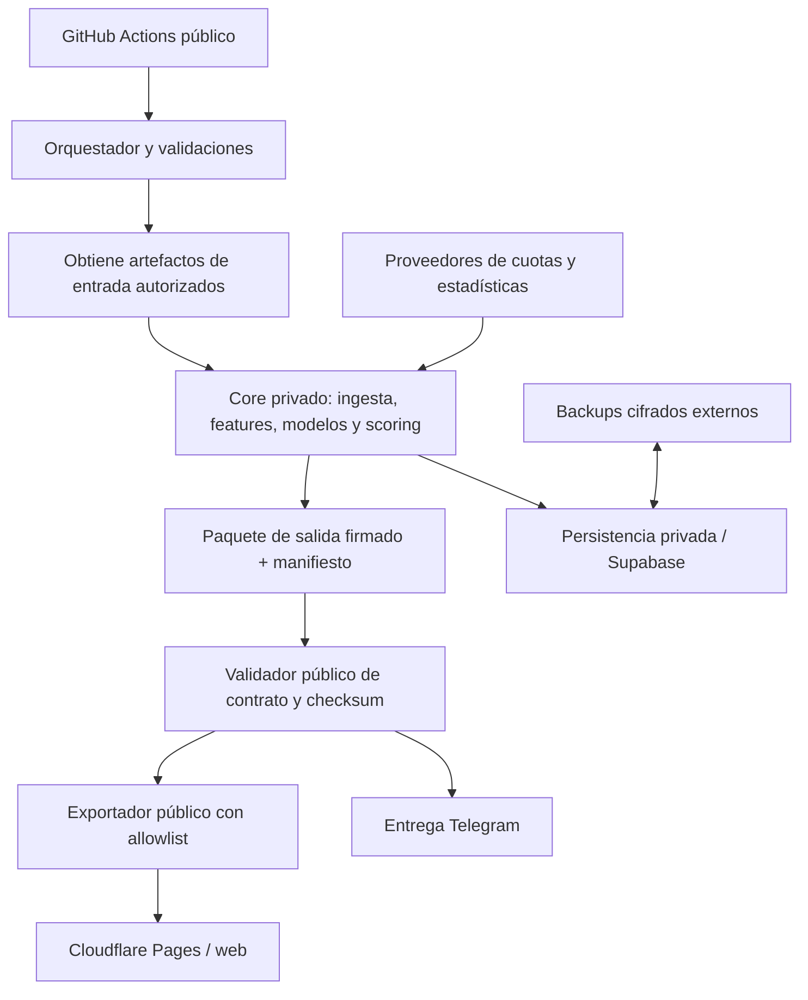

# Inventario operativo y dependencias de GitHub Actions

> Corte de auditoría: rama `hardening/free-audit-2026-10`. Fuente primaria: los 18 YAML de `.github/workflows/`.
> Este documento distingue lo **observado en YAML** de lo **inferido por nombres/llamadas**. Antes de extraer un módulo al core privado, hay que confirmar sus imports transitivos, rutas de archivos, variables de entorno y escrituras reales.

## 1. Principios de separación

SharPicks no debe dividirse como «mover todos los .py a otro repositorio». La frontera correcta es por responsabilidad:

- **Orquestador público:** cron y workflow_dispatch, checkout del código público, validaciones, contratos, disparo de procesos, publicación de artefactos expresamente públicos y despliegue de la web.
- **Core privado:** lógica de selección/valor, modelos y pesos, features propietarias, calibración, datos históricos no públicos, scoring, reglas de negocio y pipelines internos.
- **Datos/servicios:** Supabase, proveedores de cuotas/estadísticas, Telegram, Gemini, Brevo y Cloudflare. Cada integración debe tener un único propietario lógico y credenciales de mínimo privilegio.
- **Contrato entre repositorios:** entrada versionada + salida versionada + manifiesto + checksum + estado. No importar módulos privados directamente desde workflows públicos ni descargar un ZIP mutable sin verificar su identidad.

## 2. Inventario de los 18 workflows

| Workflow | Cadencia / disparador observado | Scripts / acciones principales | Credenciales observadas | Clasificación propuesta |
|---|---|---|---|---|
| `cuotas_mx.yml` | `7,37 * * * *` + manual | `cuotas_mx.py`, `barrido_capa1.py`, `anclas.py`; dispara precálculo y relevo; commitea snapshots | token GitHub implícito | **Mixto**: fetch privado + orquestación pública + publicación de snapshots permitidos |
| `precalculo_dia.yml` | `23,53 * * * *` + manual | históricos, FotMob/ESPN, bajas, ITF, remates, líneas, `precalculo_dia.py`, `senal_bajas.py` | `ODDS_API_KEY` | **Core alto**; salida pública minimizada |
| `recalibrar.yml` | lunes 05:29 UTC + manual | ingesta, estadísticas, calibración, estabilidad, riesgo, patrones, motor de goles, backtest | no se detectaron secretos en YAML | **Core privado** |
| `retrain_leagues.yml` | diario 05:47 UTC + manual / workflow_run según YAML | motores por liga/deporte, snapshots, predicciones, árbitros, líneas, publicación de modelos | `GITHUB_TOKEN` declarado | **Core privado crítico**; publicación de modelos sólo mediante allowlist |
| `radar_diario.yml` | diario 06:17 UTC | `radar_errores.py` | ninguna declarada | **Mixto**: cálculo probablemente privado; reporte agregado público |
| `precalcular_rosters.yml` | diario 04:43 UTC | `espn_extras.py --solo-plantillas --dias 8` | ninguna declarada | **Mixto**: ingesta/transformación privada, caché de salida filtrada |
| `sitio_web.yml` | cada hora al minuto 41 + workflow_run | exportador, pulso, Telegram, Gemini, avisos y correo; despliega Cloudflare Pages | Supabase, HMAC de pick, Gemini, Telegram, Cloudflare, Brevo | **Mixto sensible**: dividir exportación pública de operaciones privadas |
| `respaldo_base.yml` | diario 09:15 UTC + tras retraining + manual | `respaldo_base.py`, cifrado AES-CBC/PBKDF2 y HMAC, artifact 30 días | Supabase service key, `RESPALDO_CLAVE` | **Privado obligatorio**; artefacto fuera del repo público |
| `telegram_bot.yml` | diario 10:19 UTC + manual | `pipeline_total.py --update-only`, `bot_telegram.py` | Telegram, Odds API, API-Football | **Mixto**: selección privada; entrega Telegram con salida aprobada |
| `telegram_dia_completo.yml` | diario 06:41 UTC + manual | pipeline, `bot_dia_completo.py` | Telegram, Odds API, API-Football | **Mixto**: mismo contrato de picks que bot diario |
| `claves_supabase.yml` | manual | RPC `guardar_secreto` para mover claves a Vault | Supabase y tokens Telegram/Gemini | **Privado/controlado**; nunca token del core en el orquestador |
| `vigia_limites.yml` | 01:47 y 13:17 UTC + manual | `vigia_limites.py` descargado desde el commit exacto | Supabase access/service, Telegram, Brevo | **Privado/controlado**; conservar alertas con mínimo acceso |
| `relevo.yml` | cada 3 horas + workflow_dispatch | job read-only espera; job de 5 min despacha `cuotas_mx.yml` | `actions: write` sólo en job dispatch | **Público**; coordinación sin escritura de código |
| `web_rapido.yml` | manual / eventos definidos en YAML | despliegue rápido de carpeta `web` a Cloudflare | Cloudflare | **Público** si `web/` contiene sólo assets aprobados |
| `smoke_sharpicks.yml` | PR/push según YAML | smoke de Node/web | ninguna | **Público**; jamás recibe token privado |
| `test_instalacion_limpia.yml` | PR/push según YAML | instalación limpia | ninguna | **Público**; prueba contrato y paquete público |
| `test_sharpicks_v402.yml` | PR/push según YAML | tests web/exportador/regresiones | ninguna | **Público**; fixtures sintéticos |
| `validate_sharpicks.yml` | PR/push según YAML | validación Python/JS/Deno y regresiones | ninguna | **Público**; sin acceso al core |

### Notas de exactitud

1. Las cadencias anteriores son expresiones cron declaradas, no garantías de ejecución puntual de GitHub.
2. El YAML muestra variables de entorno declaradas, no prueba que todas estén configuradas en GitHub ni que cada script las consuma.
3. Las dependencias transitivas de Python no quedan resueltas por enumerar los comandos de los YAML. El siguiente paso técnico es construir un grafo de imports por entrypoint y detectar lecturas/escrituras de archivos.
4. `sitio_web.yml` y `retrain_leagues.yml` tienen efectos externos. No deben trasladarse como un bloque sin separar cálculo, exportación y publicación.
5. El flujo de respaldo actual sube artefactos a GitHub Actions. Mientras el repositorio sea público, el cifrado protege confidencialidad si la clave es robusta, pero no resuelve por sí solo retención, restauración, custodia de clave ni separación del plano público.

## 3. Contratos que debe implementar el core privado

Cada ejecución del core debe aceptar un objeto de entrada inmutable y producir un paquete autocontenido. No debe leer el workspace público por rutas arbitrarias.

### Entrada mínima

- `contract_version`: versión semántica del contrato.
- `run_id`: UUID generado por el orquestador.
- `as_of_utc`: timestamp UTC ISO-8601.
- `sport_scope`: deportes solicitados, normalizados.
- `event_window`: rango de eventos.
- `input_manifest`: lista de nombres lógicos, versión, SHA-256, tamaño y clasificación.
- `parameters`: parámetros permitidos por esquema; sin secretos.
- `requested_outputs`: conjunto explícito de productos de salida.

### Salida mínima

- `contract_version`, `run_id`, `started_at_utc`, `completed_at_utc`.
- `status`: `success | partial | failed`.
- `core_version` y commit SHA del core.
- `input_manifest` y `output_manifest` con SHA-256.
- `warnings` y errores estructurados sin secretos ni datos personales.
- `public_payloads`: sólo objetos aprobados para la web/Telegram.
- `private_artifacts`: referencias internas, nunca incluidas en payloads públicos.
- `metrics`: duración, eventos procesados, descartes y cobertura.

### Reglas del contrato

- Rechazar versiones desconocidas y campos obligatorios ausentes.
- Fallar cerrado ante checksum incorrecto, artefacto no firmado o versión no permitida.
- No ejecutar código descargado desde un artefacto.
- No incluir rutas locales, tokens, claves, trazas con headers ni datos completos de proveedores.
- Salida determinista para el mismo conjunto de entradas y parámetros, salvo componentes explícitamente estocásticos.
- Idempotencia por `run_id` y clave natural de evento/mercado.
- Un `partial` nunca debe confundirse con `success` para publicar picks o liquidar resultados.

## 4. Mapa de flujos y dependencias

**Importante:** el diagrama es el estado objetivo, no describe la arquitectura desplegada hoy.

## 5. Plan de extracción por oleadas

| Oleada | Qué mover | Qué se queda público | Gate de salida |
|---|---|---|---|
| 0 — Preparación | nada | workflows actuales | inventario de imports, secretos, datos y side effects; backups restaurables |
| 1 — Paquete de contrato | schemas, fixtures sintéticos y validador | CI, cron, dispatch | tests de compatibilidad y checksum |
| 2 — Core de scoring | scoring, selección, modelos y reglas | invocación y validación de salida | shadow run y diff de picks por al menos 14 días |
| 3 — Ingesta y precálculo | conectores y transformaciones propietarias | scheduler y estado de ejecución | cobertura, frescura, límites de API y recuperación |
| 4 — Recalibración/retraining | entrenamiento, calibración, backtests y modelos | disparo, seguimiento y release público filtrado | reproducibilidad, métricas, rollback de modelo |
| 5 — Mensajería | generación de mensajes y segmentación | envío final o gateway mínimo | no duplicación, idempotencia, pruebas con chat de prueba |
| 6 — Web y datos | exportador privado y backend de acceso | assets estáticos, contrato público | prueba de fuga de datos y despliegue canario |
| 7 — Backup/operación | backup, restore, monitorización y secretos | sólo health checks no sensibles | restore probado y alertas operativas |

No mover oleadas 3–7 antes de estabilizar la oleada 2. El motor de selección es el componente con mayor riesgo funcional.

## 6. Matriz de secretos y permisos

| Secreto / variable | Uso observado | Repositorio recomendado | Permiso recomendado |
|---|---|---|---|
| `SUPABASE_SERVICE_KEY` | lectura/escritura administrativa, backup, Vault | sólo core/servicio backend | no exponer al runner público |
| `SUPABASE_ACCESS_TOKEN` | API de administración en vigilante | sólo operación privada | mínimo alcance y rotación |
| `ODDS_API_KEY`, `API_FOOTBALL_KEY` | ingesta | core privado | limitar cuotas y entorno |
| `TELEGRAM_BOT_TOKEN` | envío y Vault | gateway privado | no compartir con CI público |
| `TELEGRAM_CHAT_ID`, `TELEGRAM_CHAT_VIP`, `TELEGRAM_CHAT_GRATIS` | destinos | core/gateway | tratar como configuración sensible |
| `GEMINI_API_KEY` | generación IA | core privado | presupuesto y límites |
| `PICK_ID_CLAVE` | HMAC de identificadores de picks | core/exportador privado | rotación coordinada; no duplicar |
| `RESPALDO_CLAVE` | cifrado y firma de backup | sistema de backup privado | custodia fuera de GitHub público |
| `BREVO_API_KEY`, `BREVO_REMITENTE` | correo | gateway privado | alcance de envío mínimo |
| `CLOUDFLARE_API_TOKEN`, `CLOUDFLARE_ACCOUNT_ID` | deploy Pages | deploy público separado | token limitado al proyecto Pages |
| `GITHUB_TOKEN` | Actions, checkout/releases | workflow que lo necesite | permisos YAML mínimos, nunca PAT personal |

La tabla es una recomendación de destino, no una afirmación de que los secretos ya se hayan movido. No copiar secretos a ambos repositorios «por comodidad».

## 7. Pruebas obligatorias por workflow

- **Pruebas unitarias:** transformaciones, filtros, normalización de equipos/ligas, cálculo de probabilidades y scoring.
- **Contrato:** JSON Schema, campos requeridos, compatibilidad hacia atrás y rechazo de versiones futuras.
- **Integración:** mock de proveedores y Supabase de staging; timeouts, 429, 5xx y datos incompletos.
- **Idempotencia:** dos ejecuciones con mismo `run_id` no duplican picks, notificaciones, snapshots ni liquidaciones.
- **Seguridad:** logs sin secretos, artefactos no ejecutables, allowlist de archivos y rechazo de payload privado.
- **Operación:** retry con backoff, timeout, cancelación, concurrencia y recuperación desde último checkpoint.
- **Shadow:** comparar salida del core privado con producción actual sin publicar ni enviar mensajes.
- **Canary:** habilitar primero un único deporte/mercado o un único canal de prueba.

## 8. Bloqueos que impiden declarar la migración terminada

- No hay evidencia de un repositorio privado de core creado ni de una conexión entre ambos.
- No se ha configurado un token de lectura del core en el orquestador; no debe compartirse en chat.
- No se ha ejecutado un escaneo histórico completo de secretos ni un inventario exhaustivo de releases/artefactos.
- No se ha probado restauración completa del backup.
- No se ha validado en staging el comportamiento real de RLS, grants, vistas y funciones.
- No hay shadow run comparativo del core.
- No se han medido regresiones funcionales de los 18 workflows tras separación.
- Las migraciones SQL de hardening siguen siendo propuestas pendientes de staging.

## 9. Checklist de revisión de cada extracción

- [ ] Imports transitivos inventariados y pin de dependencias.
- [ ] Archivos de entrada/salida y tamaños máximos documentados.
- [ ] Secretos identificados y eliminados de la superficie pública.
- [ ] Datos personales/proprietary clasificados.
- [ ] Contrato versionado y fixtures sintéticos.
- [ ] Checksums y manifiestos verificados.
- [ ] Tests unitarios, integración, contrato y regresión.
- [ ] Ejecución shadow comparada con baseline.
- [ ] Rollback probado sin tocar la producción.
- [ ] Responsable y procedimiento de operación documentados.

## 10. Próximo trabajo técnico

El siguiente entregable no debe ser mover archivos a ciegas. Debe ser un grafo estático de imports y referencias a archivos por entrypoint, seguido por una matriz de clasificación de módulos. El grafo debe marcar nodos no resueltos (imports dinámicos, `exec`, `importlib`, subprocess y rutas construidas) como revisión manual. Sólo entonces se puede generar el primer paquete privado sin romper los flujos actuales.
