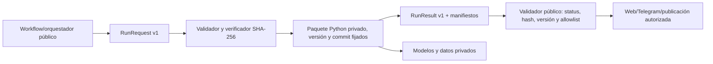

# Arquitectura objetivo de SharPicks

- **Estado global:** DISEÑADO; separación público/privado pendiente.
- **Estado implementado en esta rama:** contrato JSON v1 y validador público estándar-library; sin conexión a `sharpicks-core`.
- **Fecha de revisión:** 2026-10-30.

## Límites

### `sharpicks` público

- Workflows y orquestación pública con permisos mínimos.
- Contratos/DTOs versionados, validación de artefactos y allowlist de resultados.
- Adaptadores de servicios y presentación que no contengan reglas propietarias.
- Exportación web limitada a campos y segmentos aprobados.
- Ningún import de clases privadas ni dependencia en rutas compartidas.

### `sharpicks-core` privado

- Motores de predicción y selección, features, scoring, riesgo y reglas internas.
- Modelos/calibraciones, entrenamiento, evaluación/backtesting y datasets propietarios.
- Entry point que reciba `RunRequest` validado, manifiestos de entrada y parámetros permitidos; devolver `RunResult`.

### Flujo de datos objetivo

El flujo es un objetivo. En la rama auditada sólo se implementó el paquete contractual; el core, el paquete instalable y los flujos de datos privados no existen o no son accesibles desde la cuenta conectada.

## Decisiones

1. **Monolito modular privado primero:** el árbol actual comparte datos, nombres globales y efectos secundarios; dividir en servicios de red añadiría latencia y operación antes de aclarar límites. Extraer paquetes internos gradualmente.
2. **Contratos JSON versionados:** el orquestador intercambia DTOs autocontenidos, timestamps UTC, versión, manifiestos SHA-256 y status estructurado.
3. **Fallo cerrado:** versión desconocida, checksum/tamaño inválido, campo no permitido o resultado parcial fallan antes de publicar.
4. **Distribución propuesta:** wheel privado instalado desde checkout del repo privado fijado por commit SHA en jobs de confianza, con token GitHub App/fine-grained read-only almacenado como secret de Environment. Los detalles están en `03_ESTRATEGIA_DISTRIBUCION_CORE.md`.

## Criterios de aceptación

- Imports públicos no cruzan el límite privado.
- Contratos y checksums compatibles, con tests y fixtures sintéticos.
- Ejecución en modo sombra reproduce baseline sin enviar ni publicar.
- Versiones y hashes de código, datos y modelo quedan registrados.
- Cada workflow obtiene sólo el secreto y permiso que requiere.
- Rollback y restore privados probados antes de retirar activos públicos.

## Dependencias y riesgos

La integración depende de que el propietario cree o habilite `sharpicks-core`, defina el paquete y proporcione una credencial de sólo lectura mediante GitHub Environment. No solicitar token por chat. La separación no debe cambiar reglas de predicción sin pruebas de equivalencia.
