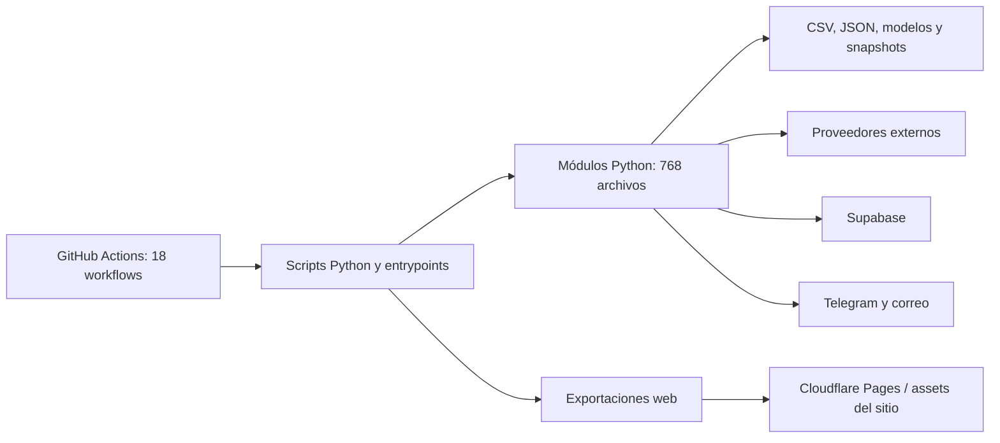

# Grafo de arquitectura actual de SharPicks

- **Estado:** OBSERVADO, grafo parcial por imports estáticos; no es un grafo completo.
- **SHA:** `228c86a7fb03ed555465e56971170565f3029d9b`.
- **Fuente complementaria:** [`GRAFO_DEPENDENCIAS_ENTRYPOINTS.md`](../GRAFO_DEPENDENCIAS_ENTRYPOINTS.md), que inventaría imports directos de 12 entrypoints.

## Vista actual

El dibujo es una vista lógica; no afirma que todas las flechas estén activas en cada entrypoint ni resuelve el grafo transitivo de imports. El flujo real por script y workflow está documentado parcialmente en el inventario previo.

## Límites demostrados y pendientes

- **OBSERVADO:** el repositorio contiene 768 archivos `.py`, 18 workflows, scripts de operación, 52 SQL, 5 modelos `.joblib`, históricos y JSON de estadísticas.
- **OBSERVADO:** el grafo existente analiza imports directos de 12 entrypoints prioritarios, entre ellos `pipeline_total.py`, `bot_telegram.py`, `league_engine.py`, `precalculo_dia.py`, `recalibrar_todo.py`, `exportar_web.py`, `respaldo_base.py`, `publicar_modelos.py` y `daily_snapshots.py`.
- **OBSERVADO:** `exportar_web.py` acopla decisiones/precálculo/tablas/liquidación con escritura de payloads web; el bot de Telegram combina generación/selección y envío.
- **PENDIENTE:** análisis recursivo de imports internos de los 768 módulos, ciclos, import side effects y dependencias instaladas desde scripts.
- **PENDIENTE:** imports dinámicos (`importlib`, `__import__`), ejecución mediante `subprocess`, `exec`, rutas calculadas, plugins y referencias construidas a nombres de módulos.
- **PENDIENTE:** inventario dinámico de archivos abiertos/escritos y trazas por entrypoint. No se ejecutan estos scripts en la línea base porque varios contactan servicios externos y producen efectos.

## Fronteras para extraer

La evidencia existente apunta a tres grupos que deben desacoplarse antes de migrar:

1. **Motor propietario:** predicción, selección, features, calibración, entrenamiento y carga de modelos.
2. **Adaptadores operativos:** cuotas/estadísticas, Supabase, archivos y APIs de terceros.
3. **Presentación/publicación:** DTOs de salida web, allowlist, gateway Telegram y workflows con permisos explícitos.

Todavía no existe una frontera de paquete real entre esos grupos en la rama auditada. La separación propuesta en el plan previo sigue siendo una arquitectura objetivo, no una arquitectura implementada.

## Procedimiento siguiente

Construir análisis AST con resolución de módulos locales y clasificación de imports dinámicos; generar aristas transitivas, ciclos y nodos no resueltos. Completar primero los entrypoints de mayor impacto y validar contra la matriz de llamadas de workflows. No presentar el resultado como completo hasta registrar explícitamente cada clase de dependencia que el analizador no resuelve.
